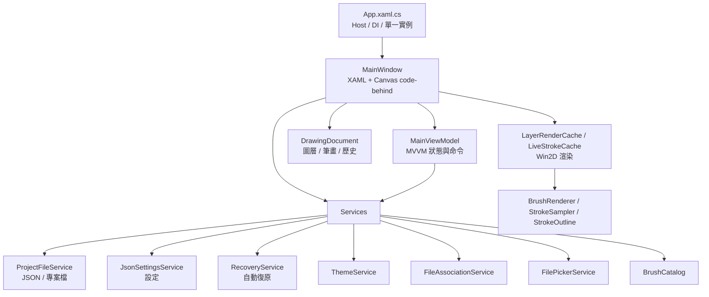
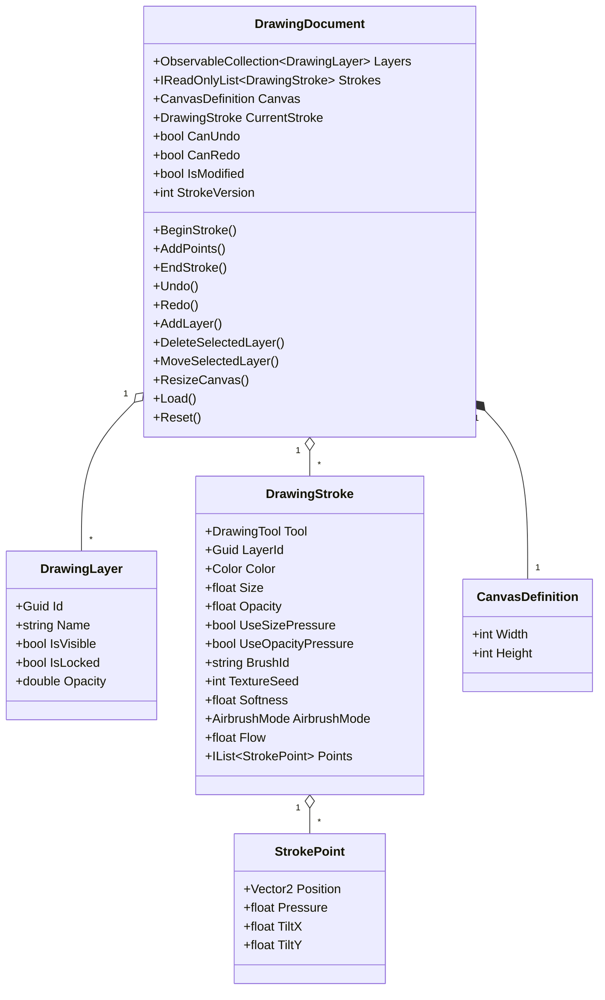

# 系統架構與技術文件

本文件描述 MyDraw 0.14.2 的技術基線、模組責任、渲染與輸入流程、資料格式、執行階段服務、測試與發行方式。

## 1. 技術基線

| 項目 | 內容 |
| --- | --- |
| 語言 | C#（nullable reference types、file-scoped namespace） |
| 目標框架 | `net10.0-windows10.0.19041.0` |
| 最低系統 | Windows 10 1809（`10.0.17763.0`） |
| UI | WinUI 3 + Windows App SDK 1.8（`1.8.251106002`） |
| 繪圖 | Win2D `Microsoft.Graphics.Win2D` 1.3.2 |
| MVVM | CommunityToolkit.Mvvm 8.4.0 |
| 啟動／DI | Microsoft.Extensions.Hosting 10.0.0 |
| 測試 | xUnit 2.9.3 + Microsoft.NET.Test.Sdk 17.14.1 |
| 架構 | x64、arm64（Release 為 framework-dependent） |
| 套件管理 | Central Package Management（`Directory.Packages.props`） |
| 版本 | `Directory.Build.props`，目前 0.14.2 |

## 2. 高階架構

MyDraw 採「View（XAML + code-behind） → ViewModel → Services／Models」分層。WinUI 的 `CanvasControl` 繪製與指標事件必須由 code-behind 處理，因此 `MainWindow.xaml.cs` 負責畫布互動與渲染協調，商業規則與狀態集中於 `DrawingDocument`、`MainViewModel` 與服務層。



## 3. 專案結構

```text
src/MyDraw/
  App.xaml / App.xaml.cs          Host、DI、單一實例、命令列開檔
  Views/
    MainWindow.xaml / .xaml.cs    主視窗、工具列、畫布事件與渲染協調
    CursorGrid.cs                 畫布游標覆蓋層
  ViewModels/
    MainViewModel.cs              工具狀態、筆刷預設、最愛、命令
  Models/
    DrawingStroke.cs              一次筆畫（工具、顏色、參數、點）
    DrawingLayer.cs               圖層（名稱、可見性、鎖定、透明度）
    StrokePoint.cs                點（位置、壓力、傾斜）
    CanvasDefinition.cs           畫布尺寸（64–8192）
    BrushPreset.cs / BrushToolSettings.cs / FavoriteBrush.cs
    AppSettings.cs / DisplayMode.cs / ColorTheme.cs
    DrawingTool.cs / AirbrushMode.cs / PressureCurve.cs
  Services/
    DrawingDocument.cs            文件狀態、歷史、變更通知
    ProjectFileService.cs         .mydraw 讀寫與驗證
    JsonSettingsService.cs        settings.json 原子寫入與隔離
    RecoveryService.cs            30 秒快照、7 天清理、復原資訊
    ThemeService.cs               ElementTheme + 主題資源字典
    FileAssociationService.cs     HKCU .mydraw 關聯
    FilePickerService.cs          Win32 視窗化的檔案選擇器
    ProjectForwardingService.cs   具名管道轉送開檔
    BrushCatalog.cs               內建筆刷預設
  Rendering/
    LayerRenderCache.cs           每圖層 512px 圖塊快取
    LiveStrokeCache.cs            進行中筆畫的圖塊快取
  Helpers/
    BrushRenderer.cs              各工具的 Win2D 繪製
    StrokeSampler.cs              Catmull-Rom 平滑、重取樣、收尾
    StrokeOutline.cs              幾何外框
    PreparedStroke.cs             取樣與外框的預先計算
    CanvasViewport.cs             縮放與平移座標轉換
    ProjectActivation.cs          命令列／啟動參數解析
    CrashLogger.cs                當機記錄
  Styles/                         共用樣式與 5 種主題資源字典
  Strings/zh-Hant、en-US/         .resw 資源
tests/MyDraw.Tests/               xUnit 測試
tools/                            PowerShell 驗證腳本
docs/                             專案文件與開發紀錄
```

## 4. 啟動與依賴注入

`App.OnLaunched` 流程：

1. 使用 `AppInstance.FindOrRegisterForKey("MyDraw.Main")` 判斷是否為第一個實例。
2. 若非第一個實例，解析命令列中的 `.mydraw` 路徑，透過具名管道轉送給既有實例後結束。
3. 建立 `Host`，註冊單例服務：
   - `ISettingsService` → `JsonSettingsService`
   - `ThemeService`、`BrushCatalog`、`FileAssociationService`、`FilePickerService`
   - `IProjectFileService` → `ProjectFileService`
   - `RecoveryService`、`DrawingDocument`、`MainViewModel`、`MainWindow`
4. 建立並顯示 `MainWindow`。
5. 啟動 `ProjectForwardingService` 監聽管道，並處理命令列帶入的專案路徑。

`MainWindow` 載入後會：

- 套用儲存的外觀主題。
- 檢查是否有復原快照，必要時顯示復原／捨棄對話框。
- 啟動 30 秒自動復原計時器。
- 將畫布縮放至適合視窗並置中。

## 5. 資料模型



### 5.1 執行階段狀態

- **Layers**：`ObservableCollection<DrawingLayer>`，順序即顯示順序（索引 0 為最上層）。
- **Strokes**：全域筆畫清單，筆畫以 `LayerId` 歸屬圖層；渲染時依圖層分組。
- **CurrentStroke**：正在進行的筆畫，尚未進入歷史。
- **StrokeVersion**：每次筆畫集合變動（新增、復原、重做、載入、畫布尺寸變更）遞增，用於通知渲染快取同步。
- **歷史**：`Stack<HistoryEntry>` 的 undo／redo；`HistoryEntry` 封裝 `Undo`／`Redo` 動作。
- **IsModified**：由「目前 undo 疊頂端」與存檔時記錄的狀態 token 比較，另加 `_forceModified`（畫布尺寸等非歷史變更）與進行中筆畫判斷。

## 6. 渲染架構

### 6.1 畫布與圖層

`MainWindow.xaml` 內有兩個 `CanvasControl`：

- **DrawingCanvas**：實際圖層內容，`Draw` 事件呼叫 `RenderDocument`。
- **OverlayCanvas**：格線與筆刷游標，不參與命中測試（`IsHitTestVisible=False`）。

`RenderDocument`：

1. 清除背景、套用 `CanvasViewport` 的縮放／平移矩陣。
2. 建立白色紙張圖層。
3. 依 `Layers.Reverse()` 由下而上繪製可見圖層。
4. 每個圖層使用對應的 `LayerRenderCache`；進行中的筆畫使用 `LiveStrokeCache`。
5. 圖層透明度小於 1 時以 `CanvasActiveLayer` 套用整體透明度。

### 6.2 圖塊快取

`LayerRenderCache` 將每個圖層切成 **512 × 512** 的 `CanvasRenderTarget` 圖塊：

- `Synchronize` 依 `StrokeVersion` 與目前筆畫清單同步。
- 新筆畫只渲染受影響圖塊。
- 復原最後一筆時：
  1. 以被移除筆畫的 bounds 找出 dirty 圖塊。
  2. 做「dirty 圖塊閉包」：任何碰到 dirty 圖塊的剩餘筆畫，其涵蓋圖塊也加入 dirty。
  3. 清除所有 dirty 圖塊，重畫所有碰到 dirty 圖塊的筆畫。
  4. 若 dirty 範圍過大，退回整層重建。
- 這個做法可避免同圖塊其他筆畫被誤刪，也避免半透明筆刷在圖塊邊界重複疊加。
- 圖塊建立時依 `GetRenderDpi()` 決定 DPI；畫布面積超過約 1200 萬像素時固定 96 DPI，其餘限制在 96–144 DPI。

`LiveStrokeCache` 用於進行中的筆畫：

- 只更新新筆點影響的圖塊。
- 每次新點進來時重新準備筆畫並重畫受影響區段。
- 與 `LayerRenderCache` 相同，使用 512px 圖塊。

### 6.3 筆刷渲染

`BrushRenderer` 依工具分派：

- 鋼筆／原子筆／螢光筆等：以 `StrokeSampler` 取樣，透過筆尖遮罩或幾何外框繪製。
- 鉛筆／蠟筆：材質顆粒與隨機種子（`TextureSeed`）。
- 噴槍：霧狀（Mist）或顆粒（Grain），依固定弧長密度灑點。
- 書法筆：依筆尖方向、傾斜與筆畫方向改變寬度。
- 橡皮擦：以 `CanvasBlend` 清除像素，支援柔和邊緣。
- 螢光筆：半透明、扁平筆尖，重疊不累積加深。

`StrokeSampler`：

- 使用 Catmull-Rom 曲線平滑位置與壓力。
- 依筆刷大小決定取樣步長，將線段重取樣為密集樣本。
- 依壓力與傾斜計算半徑。
- 對支援收尾的工具套用兩端漸細（taper）。

`StrokeOutline` 與 `PreparedStroke` 會預先計算外框與樣本，避免每一幀重複準備。

### 6.4 裝置遺失

`CanvasDevice.DeviceLost` 發生時，`MainWindow.HandleDeviceLost` 會：

1. 清除所有圖層快取與即時筆畫快取。
2. 重設同步版本。
3. 觸發畫布重繪，讓新裝置重新建立圖塊。

### 6.5 游標

- `OverlayCanvas` 繪製格線與筆刷游標。
- 游標大小與筆尖形狀依工具不同（例如書法筆斜向、螢光筆扁平）。
- 手寫筆筆尾橡皮擦會顯示對應游標。

## 7. 輸入處理

`DrawingCanvas` 事件：

| 事件 | 行為 |
| --- | --- |
| `PointerPressed` | 判斷是否平移（平移工具、空白鍵、滑鼠右鍵），否則建立 `DrawingStroke` 並 `BeginStroke`。 |
| `PointerMoved` | 更新游標；平移時移動視埠；繪圖時將 intermediate points 轉為畫布座標並加入筆畫。 |
| `PointerReleased` | 補上最後一點並 `EndStroke`。 |
| `PointerCaptureLost` | 結束目前互動，避免筆畫卡住。 |
| `PointerWheelChanged` | 以游標位置為中心縮放 0.1–4 倍。 |

其他重點：

- 壓力正規化至 0–1，滑鼠固定為 1.0。
- 支援 X/Y 傾斜（`XTilt`、`YTilt`）。
- 套用壓力曲線（柔和／線性／銳利）後才寫入 `StrokePoint`。
- 點與點之間有最小距離與壓力差過濾，避免過度密集。
- 鎖定或隱藏的圖層不接受繪圖。
- 畫布外不開始筆畫。

## 8. `.mydraw` 專案格式

`.mydraw` 是一個 ZIP 容器，目前格式版本 **6**：

```text
project.mydraw
├─ manifest.json
└─ document.json
```

### 8.1 manifest.json

```json
{
  "Format": "MyDraw",
  "FormatVersion": 6,
  "AppVersion": "0.14.2.0"
}
```

### 8.2 document.json

```json
{
  "Width": 1080,
  "Height": 1080,
  "Layers": [
    {
      "Id": "guid",
      "Name": "圖層 1",
      "IsVisible": true,
      "IsLocked": false,
      "Opacity": 1
    }
  ],
  "Strokes": [
    {
      "LayerId": "guid",
      "BrushId": "builtin.ballpoint",
      "Tool": "Ballpoint",
      "Color": 4278190080,
      "Size": 4,
      "Opacity": 1,
      "UseSizePressure": false,
      "UseOpacityPressure": false,
      "TextureSeed": 123456,
      "Softness": 0,
      "AirbrushMode": "Mist",
      "Flow": 1,
      "Points": [
        { "X": 100, "Y": 120, "Pressure": 1, "TiltX": 0, "TiltY": 0 }
      ]
    }
  ]
}
```

### 8.3 讀寫策略

- 儲存前先將既有檔案複製為 `<檔名>.mydraw.bak`（可關閉）。
- 寫入暫存檔 `<檔名>.<guid>.tmp`，成功後以 `File.Move(..., overwrite: true)` 原子替換。
- 載入時驗證：
  - `manifest.json` 存在且 `Format == "MyDraw"`。
  - `FormatVersion` 介於 1 與目前版本之間。
  - 畫布尺寸 64–8192。
  - 至少一個圖層；不存在的圖層參照會被忽略。
  - 工具列舉值有效；`Pan` 不寫入筆畫。
  - 數值會夾在合法範圍（尺寸 1–80、不透明度 5%–100%、柔和度／流量 0–1）。
- 錯誤以 `ProjectFileException` 搭配資源 key 呈現，避免直接顯示技術訊息。

## 9. 設定與本機資料

### 9.1 設定

- 位置：`%LOCALAPPDATA%\MyDraw\settings.json`
- 格式：JSON，列舉以字串儲存（`JsonStringEnumConverter`）。
- 寫入：
  - `Save()`：立即原子寫入。
  - `SaveDebounced()`：300ms 去抖後寫入，適合滑桿等高頻變更。
- 損毀處理：無法解析時改名為 `settings.json.corrupt`，並使用預設值。
- 內容：視窗位置／大小、顯示模式、色彩主題、工具列位置、最近專案、每支筆刷設定、最愛畫筆。

### 9.2 自動復原

- 位置：`%LOCALAPPDATA%\MyDraw\Recovery\`
- 每次啟動建立新的 session id，檔名為 `<sessionId>.mydraw` 與 `<sessionId>.json`。
- 每 30 秒（`DispatcherQueueTimer`）在文件有修改時寫入快照；進行中的筆畫也會一併寫入。
- 啟動時讀取最新且檔案存在的 `.json`，提示復原或捨棄。
- 超過 7 天的快照會自動清理。
- 正常關閉：
  - 有未儲存變更：先寫入最後快照再關閉。
  - 無變更：清除本次 session 的復原檔。

### 9.3 當機記錄

- 位置：`%LOCALAPPDATA%\MyDraw\logs\crash-YYYYMMDD.log`
- 來源：`Application.UnhandledException`、`AppDomain.UnhandledException`、`TaskScheduler.UnobservedTaskException`。
- 只追加時間、來源與例外內容，不含畫布資料。

## 10. 單一實例與檔案啟用

- 金鑰：`AppInstance.FindOrRegisterForKey("MyDraw.Main")`。
- 第二次啟動時：
  1. 解析命令列中的 `.mydraw`。
  2. 透過具名管道 `MyDraw.OpenProject.<使用者名稱>` 將路徑傳給既有實例。
  3. 使用 `RedirectActivationToAsync` 將啟用事件轉送後結束。
- 既有實例收到路徑後，由 `MainWindow.QueueOpenProject` 排程開啟。
- `.mydraw` 關聯由 `FileAssociationService` 寫入 `HKCU\Software\Classes`，包含 ProgId、圖示與開啟命令，並呼叫 `SHChangeNotify` 通知殼層。

## 11. 匯出

- `CreateExportSnapshot` 建立畫布尺寸、圖層與筆畫的不可變快照。
- 在背景執行緒使用 Win2D `CanvasRenderTarget` 重新渲染，依可見圖層與透明度合成。
- 進度以 `Progress<double>` 回報至 `ContentDialog` 的 `ProgressBar`。
- 支援 `CancellationToken`；取消時刪除半成品檔案。
- 匯出固定 96 DPI，輸出尺寸等於畫布像素尺寸。

## 12. 主題、資源與在地化

- 介面文字放 `Strings/zh-Hant/Resources.resw` 與 `Strings/en-US/Resources.resw`，透過 `x:Uid` 或 `ResourceLoader` 取得。
- 資源 key 需在兩個語言檔保持一致（由 `ResourceParityTests` 驗證）。
- 主題樣式在 `Styles/AppStyles.xaml` 與 `Styles/Themes/*.xaml`。
- `ThemeService` 設定 `FrameworkElement.RequestedTheme`，並替換合併字典以套用色彩主題。
- 未封裝 WinUI 版本不支援執行期手動切換 UI 語言，介面語言跟隨 Windows 語言。

## 13. 無障礙與 DPI

- 主要按鈕與畫布提供 `AutomationProperties.AutomationId`、`Name`、`HelpText`。
- 工具狀態使用 `AutomationProperties.LiveSetting="Polite"`。
- `app.manifest` 宣告 Per-Monitor V2 DPI 感知。
- 圖示提供多尺寸（`.ico`、SVG、256px PNG）。
- 視窗有最小尺寸限制，避免工具列被壓縮到不可用。

## 14. 錯誤處理原則

- 服務層以明確例外型別回報（`ProjectFileException`、`IOException`、`UnauthorizedAccessException` 等）。
- UI 層以 `ContentDialog` 顯示使用者可理解的訊息，技術細節寫入記錄。
- 非致命錯誤（設定讀寫、復原快照、當機記錄）以 `ILogger` 記錄並繼續執行。
- 不吞掉未預期的例外；由全域處理常式寫入當機記錄。

## 15. 測試策略

### 15.1 單元測試

`tests/MyDraw.Tests` 使用 xUnit，涵蓋：

- `StrokeSampler`：平滑、取樣、壓力與收尾。
- `DrawingDocument`：筆畫、圖層、undo／redo、存檔狀態、載入。
- `ProjectFileService`：round-trip、備份、損壞檔案、版本與資料驗證。
- `MainViewModel`：最愛畫筆、工具設定、最近專案。
- `LayerRenderCache`：復原最後一筆時同圖塊其他筆畫保留（Win2D 像素驗證）。
- `HighlighterRendering`、`BrushFlow`、`Win2DRendering`：筆刷渲染輸出。
- `ResourceParity`：中英文資源 key 對齊。
- `ProjectActivation`：命令列路徑解析。

### 15.2 驗證腳本

| 腳本 | 用途 |
| --- | --- |
| `tools/Verify-UiSmoke.ps1` | UI Automation 全流程 smoke（工具、圖層、畫圓、復原、全螢幕、最愛畫筆、延遲）。 |
| `tools/Verify-BrushEffects.ps1` | 噴槍密度、顆粒、橡皮擦、鉛筆透明度。 |
| `tools/Verify-OpenExport.ps1` | 開檔、匯出與檔案選擇器流程。 |

### 15.3 測試分級

- **Tier 1**：每次影響編譯或 XAML 的修改後執行 Debug build。
- **Tier 2**：功能完成時執行 `dotnet format`、`dotnet test` 與相關驗證腳本。
- **Tier 3**：版本更新或發行前執行完整 `Verify-UiSmoke.ps1`，渲染變更再手動視覺確認。

## 16. 建置與發行

### 16.1 開發建置

```powershell
dotnet restore MyDraw.sln
dotnet build MyDraw.sln -c Debug -p:Platform=x64
dotnet test MyDraw.sln -c Debug -p:Platform=x64
dotnet format MyDraw.sln --verify-no-changes --no-restore
```

### 16.2 多架構

`MyDraw.csproj` 使用條件式屬性：

- `Platforms`：`x64;arm64`
- `PlatformTarget`：依 `Platform` 決定，預設 x64。
- `RuntimeIdentifier`：依 `Platform` 決定，預設 `win-x64`；arm64 為 `win-arm64`。
- 命令列可用 `-r win-arm64` 覆寫。

### 16.3 non-self-contained 發行

```powershell
# x64
dotnet publish src\MyDraw\MyDraw.csproj -c Release -p:Platform=x64 -r win-x64 `
  --self-contained false -p:WindowsAppSDKSelfContained=false `
  -p:WindowsPackageType=None -o publish\win-x64

# arm64
dotnet publish src\MyDraw\MyDraw.csproj -c Release -p:Platform=arm64 -r win-arm64 `
  --self-contained false -p:WindowsAppSDKSelfContained=false `
  -p:WindowsPackageType=None -o publish\win-arm64
```

特性：

- 不含 .NET 執行階段（無 `coreclr.dll`、`hostfxr.dll`）。
- 不含 Windows App SDK 執行階段（無 `Microsoft.WindowsAppRuntime.dll`）。
- 需要使用者安裝 .NET 10 Desktop Runtime 與 Windows App SDK 1.8 Runtime。
- 輸出資料夾可直接壓縮散布。

### 16.4 self-contained 發行（可選）

將參數改為 `--self-contained true -p:WindowsAppSDKSelfContained=true`，會一併附帶 .NET 與 Windows App SDK，檔案較大但免安裝 Runtime。

### 16.5 版本規則

- 版本在 `Directory.Build.props`：`Version`、`AssemblyVersion`、`FileVersion`。
- `Version` 採 `主.次.修`；每次功能變更遞增。
- `AssemblyVersion` 僅在主／次版變更時調整。
- 發行時同步更新 `CHANGELOG.md`、`RELEASE_NOTES.md`、`docs/DEV_LOG.md`。

## 17. 效能考量

- 以 512px 圖塊避免每次重畫整個圖層。
- 已完成的筆畫不逐幀重播，只重畫變更圖塊。
- 進行中的筆畫只更新新點影響的圖塊。
- 超大畫布降低渲染 DPI 以控制記憶體與 GPU 成本。
- 設定寫入去抖 300ms，避免滑桿操作造成大量磁碟 I/O。
- 自動復原在背景執行緒寫入，並以 `_saving` 避免重入。
- 圖層快取依圖層 id 建立，刪除圖層時釋放對應 `CanvasRenderTarget`。

## 18. 已知技術限制

- 圖層屬性與畫布尺寸變更未納入 undo／redo。
- 復原歷史未做上限，極長時間繪圖可能佔用較多記憶體。
- 每次載入專案會重建所有圖層圖塊，超大專案首次顯示較慢。
- 未封裝 WinUI 無法在執行期切換 UI 語言。
- 尚未提供 PDF／JPG 匯出、圖層混合模式或雲端同步。
