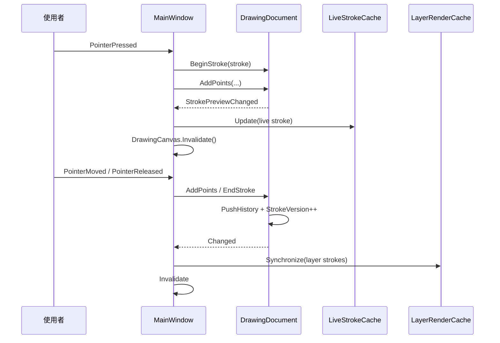
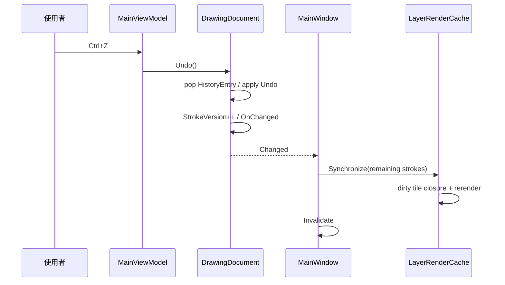
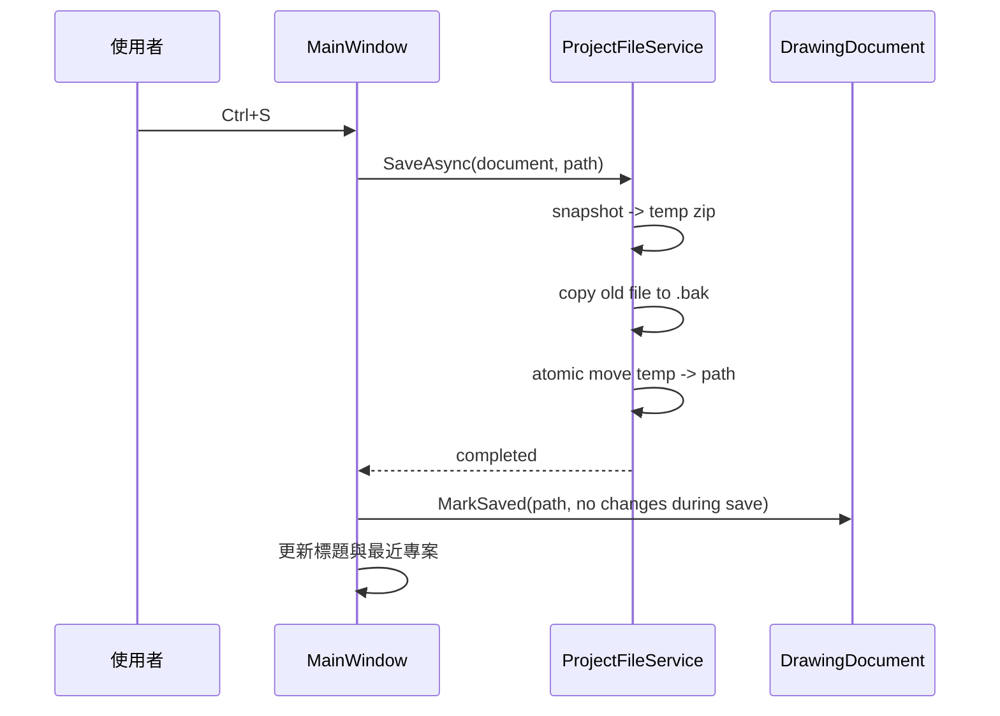
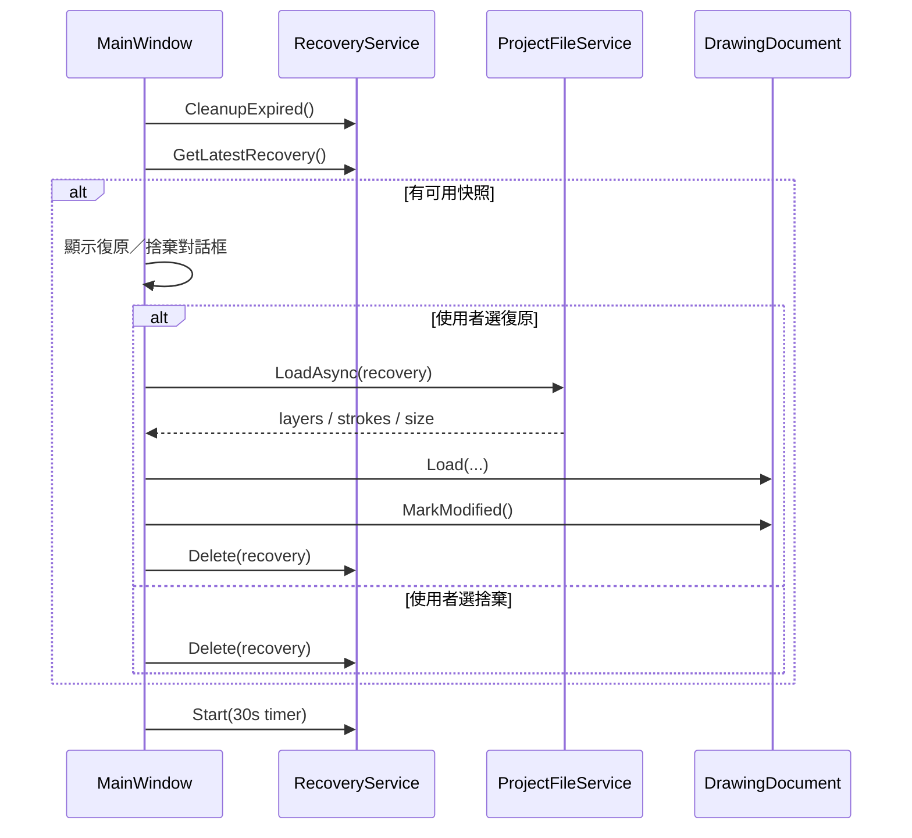
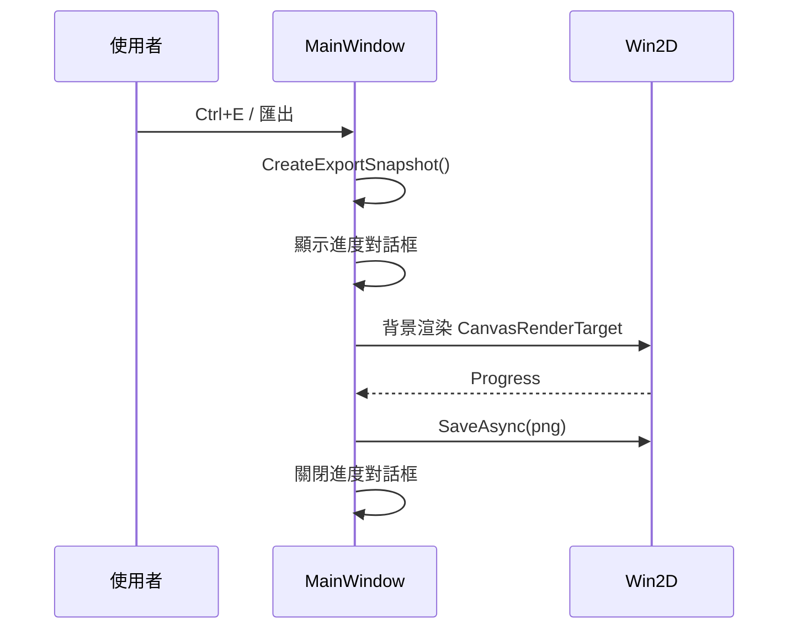
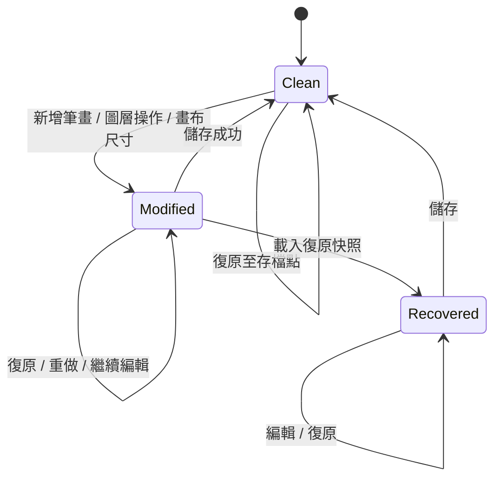

# 系統設計文件

本文件說明 MyDraw 0.14.2 的設計目標、品質屬性、模組責任、關鍵設計決策、主要流程、錯誤處理與未來擴充方向。實作細節與類別說明請搭配 [系統架構與技術文件](系統架構與技術文件.md) 閱讀。

## 1. 設計目標與品質屬性

| 品質屬性 | 目標 | 對應設計 |
| --- | --- | --- |
| 啟動速度 | 冷啟動後快速取得可畫畫布 | 不載入專案精靈、預設建立單一圖層、非同步初始化復原檢查 |
| 輸入延遲 | 手寫跟手、不因歷史增長而變慢 | 圖層圖塊快取、即時筆畫圖塊快取、只重畫受影響區域 |
| 資料安全 | 當機或誤關閉後可復原 | 30 秒自動快照、關閉前寫入、`.bak`、原子寫入 |
| 操作集中 | 常用功能不分散 | 單一工具列 + Flyout、可切換左右、沉浸模式 |
| 可維護性 | UI 與商業邏輯分離 | MVVM、服務層、依賴注入、單元測試 |
| 可存取性 | 鍵盤與輔助技術可用 | 快捷鍵、AutomationId、AutomationProperties、LiveSetting |
| 可攜性 | 不依賴安裝程式 | 未封裝（unpackaged）WinUI、ZIP 發行、使用者層級檔案關聯 |

## 2. 設計原則

1. **單一畫布優先**：所有工具與面板圍繞同一畫布，避免多視窗切換成本。
2. **資料與呈現分離**：`DrawingDocument` 負責狀態與歷史；View 只負責呈現與輸入。
3. **漸進式渲染**：只重畫變更區域，完整重建是最後手段。
4. **安全預設**：破壞性操作需確認；設定與專案以原子方式寫入。
5. **可回推狀態**：只要有變更，就要能判斷是否與上次儲存不同。
6. **在地化優先**：使用者可見文字一律走資源檔，預設繁體中文。
7. **不引入不必要依賴**：套件集中管理，新增依賴需有明確理由。

## 3. 系統組成與責任

| 元件 | 責任 | 不負責 |
| --- | --- | --- |
| `App` | 啟動、DI、單一實例、命令列轉送 | 繪圖邏輯 |
| `MainWindow` | 版面、事件、畫布繪製協調、對話框 | 持久化格式細節 |
| `MainViewModel` | 工具狀態、筆刷預設、最愛、命令 | 筆畫歷史 |
| `DrawingDocument` | 圖層、筆畫、歷史、修改狀態 | UI 呈現 |
| `ProjectFileService` | `.mydraw` 讀寫、驗證、備份 | 檔案選擇器 |
| `JsonSettingsService` | 設定載入／儲存、損毀隔離 | 主題套用 |
| `RecoveryService` | 定期快照、復原資訊、清理 | 復原 UI |
| `ThemeService` | 顯示模式與色彩主題 | 樣式定義 |
| `FileAssociationService` | `.mydraw` 關聯 | 開檔流程 |
| `ProjectForwardingService` | 第二實例開檔轉送 | 專案載入 |
| `LayerRenderCache` / `LiveStrokeCache` | 圖層與即時筆畫渲染快取 | 輸入處理 |
| `BrushRenderer` / `StrokeSampler` | 筆刷幾何與材質 | 文件狀態 |

## 4. 關鍵設計決策

### 4.1 WinUI 3 + Win2D

- **決策**：使用 WinUI 3 作為 UI、Win2D 作為畫布。
- **理由**：原生 Fluent 控制項、Windows 10/11 一致體驗；Win2D 提供 GPU 加速與成熟的幾何／影像 API。
- **代價**：WinUI 3 需要 Windows App SDK Runtime；部分控制項行為與 WPF 不同。

### 4.2 畫布仍使用 code-behind

- **決策**：`CanvasControl` 的 `Draw` 與 pointer 事件留在 `MainWindow.xaml.cs`。
- **理由**：Win2D 與指標事件高度依賴 UI 執行緒與視覺樹；強行 MVVM 會增加抽象成本。
- **折衷**：狀態與命令仍放 `MainViewModel`／`DrawingDocument`，code-behind 只做協調。

### 4.3 圖層圖塊快取

- **決策**：每個圖層以 512 × 512 `CanvasRenderTarget` 圖塊快取。
- **理由**：完成筆畫不需每幀重播；新增／復原只更新局部。
- **代價**：圖塊邊界需要正確失效，否則會出現接縫或殘影；已用 dirty 圖塊閉包處理。

### 4.4 專案格式採 ZIP + JSON

- **決策**：`.mydraw` 為 ZIP，內含 `manifest.json` 與 `document.json`。
- **理由**：易於除錯、可壓縮、可向後相容版本欄位；不需要額外序列化套件。
- **代價**：大型專案載入時需完整解析 JSON；目前已可接受。

### 4.5 undo／redo 以動作紀錄實作

- **決策**：`HistoryEntry` 儲存 undo／redo 委派，而非整份文件快照。
- **理由**：記憶體效率高，能精準重畫受影響圖層。
- **代價**：每個新動作都要正確實作反向操作；未納入歷史的變更需另以 `IsModified` 處理。

### 4.6 自動復原與關閉行為

- **決策**：關閉時不詢問是否儲存；有變更時先寫入復原快照再關閉。
- **理由**：降低關閉流程摩擦，同時保留資料。
- **代價**：使用者下次啟動會看到復原提示；需以對話框說明來源與時間。

### 4.7 單一實例與具名管道

- **決策**：以 `AppInstance` + 具名管道轉送 `.mydraw` 路徑。
- **理由**：避免多個實例同時編輯同一檔案，並讓檔案總管開檔體驗一致。
- **代價**：管道名稱需帶使用者名稱以避免多使用者衝突。

## 5. 主要流程

### 5.1 繪製一筆

### 5.2 復原最後一筆

### 5.3 儲存專案

### 5.4 啟動復原

### 5.5 匯出 PNG

## 6. 狀態模型

### 6.1 文件狀態

- `IsModified` 由存檔時的歷史狀態 token 與目前狀態比較。
- 載入復原快照後會強制標記為已修改，避免誤以為已儲存。
- 非歷史變更（例如畫布尺寸）以 `_forceModified` 保持已修改狀態，直到下次儲存。

### 6.2 工具狀態

- 每個 `DrawingTool` 有獨立的 `BrushToolSettings`。
- 切換工具時：先記住目前工具設定，再套用新工具設定。
- 設定變更會寫入 `settings.json`（去抖 300ms）。
- 最愛畫筆是工具＋顏色＋筆刷參數的完整快照。

## 7. 錯誤與例外設計

| 情境 | 處理 |
| --- | --- |
| 專案格式錯誤 | `ProjectFileException` + 資源 key，顯示可理解訊息 |
| IO／權限錯誤 | 記錄 `ILogger`，顯示儲存／開啟失敗對話框 |
| 設定檔損毀 | 隔離為 `.corrupt`，使用預設值 |
| 復原快照損毀 | 記錄並略過，不阻擋啟動 |
| 未預期例外 | 全域處理常式寫入當機記錄 |
| 匯出取消 | 取消權杖，刪除半成品 |

原則：**不吞掉未預期例外**；可預期的檔案／權限問題要記錄並讓使用者知道結果。

## 8. 安全與隱私

- 無網路功能、無遙測、無帳號系統。
- 所有資料存於使用者本機。
- `.mydraw` 關聯僅寫入 `HKCU`，不要求系統管理員權限。
- 載入專案時對尺寸、列舉與數值做範圍驗證，避免異常資料造成不穩定。
- 當機記錄只包含例外與時間，不含畫布內容。
- 發行檔未簽章；未來可考慮程式碼簽章以降低 SmartScreen 警告。

## 9. 可存取性與在地化

- 所有可點擊的主要控制項都有 `AutomationProperties.AutomationId`，供 UI 測試與輔助技術使用。
- 圖示按鈕提供 ToolTip 與 Automation Name。
- 工具狀態透過 LiveSetting 朗讀。
- 快捷鍵涵蓋檔案、編輯、檢視與工具切換。
- 文字資源分為 zh-Hant 與 en-US，預設繁體中文。
- 主題使用 `ThemeResource`，支援淺色／深色與 5 種色彩主題。

## 10. 資料保存策略

| 資料 | 策略 |
| --- | --- |
| 專案 | 使用者選擇位置；儲存前備份 `.bak`；原子替換 |
| 設定 | `%LOCALAPPDATA%`；300ms 去抖；原子寫入；損毀隔離 |
| 復原 | 30 秒快照；關閉時寫入；7 天清理 |
| 最近專案 | 最多 10 筆；啟動時清除不存在路徑 |
| 最愛畫筆 | 存於設定檔；可重新命名、排序、刪除 |
| 當機記錄 | 每日一個檔案，追加寫入 |

## 11. 擴充點

- **新增筆刷工具**：在 `DrawingTool` 加入列舉、`BrushCatalog` 加入預設、`BrushRenderer` 加入繪製分支、UI 加入按鈕與資源字串。
- **新增匯出格式**：擴充 `FilePickerService` 與渲染輸出流程；可重用 `CreateExportSnapshot`。
- **新增檔案格式版本**：在 `ProjectFileService` 提高 `CurrentFormatVersion`，保留舊版讀取邏輯。
- **新增主題**：在 `Styles/Themes/` 加入資源字典，更新 `ColorTheme` 與設定選項。
- **新增語言**：新增 `Strings/<culture>/Resources.resw`，並確保 key 對齊。

## 12. 已知限制與未來工作

### 12.1 已知限制

- 圖層改名、透明度、顯示、鎖定與畫布尺寸未納入 undo／redo。
- 復原歷史無上限，長時間編輯可能增加記憶體使用。
- 匯出僅支援 PNG。
- 未封裝版本不支援執行期切換 UI 語言。
- arm64 已可建置與發行，但主要驗證仍以 x64 為主。
- 發行檔未簽章。

### 12.2 未來方向

1. 將圖層屬性與畫布尺寸納入歷史。
2. 歷史上限與記憶體回收策略。
3. PDF／JPG 匯出與列印。
4. 圖層混合模式、資料夾群組。
5. 筆刷外掛／自訂筆尖。
6. 程式碼簽章與自動化 CI/CD 發行。
7. arm64 實機效能與相容性驗證。

## 13. 版本與文件維護

- 本文件對應版本：0.14.2。
- 每次功能或架構變更時，應同步更新：
  - `docs/DEV_LOG.md`
  - `CHANGELOG.md`
  - `RELEASE_NOTES.md`
  - 本文件與 `系統架構與技術文件.md` 的相關段落
- 文件中的指令與路徑應以實際專案為準，避免記錄已移除的功能。
